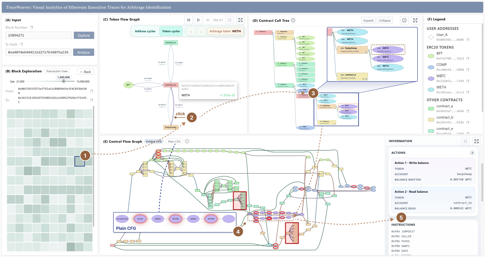

# EVM Transaction Analyzer

<p align="center">
  <a href="./system_showcase.pdf">
    
  </a>
</p>

<p align="center"><em>TraceWeaver system overview — click the image to open the PDF.</em></p>

```
evm-transaction-analyzer/
├── backend/    Python (FastAPI) analysis server
├── frontend/   Vue 3 + TypeScript visualization app
└── README.md
```

- **Backend** — Fetches transaction traces from an Ethereum node, disassembles contract bytecode into basic blocks, constructs transaction-level CFGs, extracts token transfer flows, and serves results via a FastAPI server.
- **Frontend** — Interactive dashboard using D3-Graphviz for CFG/AFG rendering and Plotly for block gas heatmap visualization.

## Prerequisites

- [UV](https://docs.astral.sh/uv/) (Python package manager, v0.4+)
- Python 3.12+
- Node.js 18+
- Access to a Geth JSON-RPC endpoint

## Using UV

UV is the Python package manager used by this project.

### Python version management

- `uv python list` — View available Python versions
- `uv python install python3.x` — Install a Python version
- `uv python uninstall python3.x` — Uninstall a Python version

### Project dependency management

- `uv add <package>` — Add a dependency (updates `pyproject.toml`)
- `uv remove <package>` — Remove a dependency
- `uv sync` — Install/sync all dependencies
- `uv lock` — Create/update the lockfile
- `uv run <command>` — Run a command in the project environment
- `uv tree` — View the dependency tree

## Setup

### Backend

```bash
cd backend
uv sync                    # Install Python dependencies
cp .env.example .env       # Create environment config
# Edit .env with your actual values
```

Environment variables (configured in `backend/.env`):

| Variable | Description |
|----------|-------------|
| `GETH_API` | URL of the Geth JSON-RPC endpoint |
| `QUICKNODE_RPC_URL` | Full QuickNode Ethereum RPC URL used for historical opcode traces |
| `QUICKNODE_ENDPOINT_NAME` | Optional QuickNode endpoint subdomain when the URL is assembled from a token |
| `QUICKNODE_API_KEY` | QuickNode endpoint token; a `QN_...` platform key alone is not an RPC URL |
| `POSTGRESQL_HOST` | PostgreSQL server host |

### Frontend

```bash
cd frontend
npm install
```

## Running

### Start the backend server

```bash
cd backend
uv run uvicorn server:app --port 9008
```

The API server starts at `http://localhost:9008`.

### Start the frontend dev server

```bash
cd frontend
npm run dev
```

The frontend starts at `http://localhost:9006`.

The frontend uses same-origin `/api` requests. During development, Vite proxies
these requests to `http://127.0.0.1:9008`. Set `VITE_API_BASE` when the API is
hosted separately (for example, `VITE_API_BASE=https://api.example.com`).

### Standalone analysis (no server)

```bash
cd backend
uv run python main.py
```

Runs the analysis pipeline on the hardcoded transaction hash in `main.py` and saves results to `data_base/analysis/`.

### Build the local function-signature database

Sequence rendering reads function names only from a complete local SQLite
mirror; it never calls 4byte.directory in the rendering path. Build or refresh
the mirror before analyzing transactions:

```bash
cd backend
uv run python signature/sync.py
```

The command mirrors every API record, resumes an interrupted `.partial` build,
and publishes `data_base/signatures/function_signatures.sqlite3` only after the
local row count matches a stable source snapshot. The current 1.179-million-row
compact snapshot occupies about 99 MiB.

To migrate an existing schema-v1 database to the compact schema without
downloading the dataset again:

```bash
cd backend
uv run python signature/sync.py --compact-existing
```

### Inspect analysis performance

Each API analysis writes `analysis_timing.json` beside its graph artifacts. It
contains total wall time, per-phase durations, and artifact sizes, and is
updated throughout the run so an interrupted analysis still leaves useful
profiling data.

```bash
jq . data_base/analysis/<tx-hash-without-0x>/analysis_timing.json
```

## API Endpoints

| Method | Path | Description |
|--------|------|-------------|
| POST | `/api/analyze` | Analyze a transaction by hash |
| GET | `/api/files/{tx_hash}/{filename}` | Retrieve analysis output files (.dot, .json, .svg) |
| POST | `/api/block` | Get block gas data for heatmap |
| GET | `/api/blocks` | Get block-level gas summary (paginated) |
| GET | `/api/transaction/{tx_hash}/block` | Get block number for a transaction |

## Key Backend Modules

| Module | Description |
|--------|-------------|
| `main.py` | Standalone pipeline and shared graph/artifact writers |
| `main_api.py` | Transaction-hash CLI pipeline used by the API server |
| `server.py` | FastAPI analysis jobs, artifact delivery, graph rendering, and block/arbitrage endpoints |
| `utils/analysis_paths.py` | Canonical per-transaction analysis output paths |
| `utils/evm_information.py` | Trace standardization, storage/token metadata extraction, and contract bytecode retrieval |
| `utils/quicknode_trace.py` | QuickNode trace retrieval and normalization fallback |
| `utils/basic_block.py` | EVM bytecode disassembly and basic-block construction |
| `utils/cfg_structure.py` | Core CFG node, edge, and graph data structures |
| `utils/cfg_transaction.py` | Plain, folded, and original transaction-level CFG construction |
| `utils/render_cfg.py` | CFG Graphviz/DOT generation and visual styling |
| `utils/cfg_slice.py` | Validated subgraph extraction for focused CFG rendering |
| `utils/extract_token_changes.py` | Transfer pairing, mint/burn recovery, approvals, balances, TFG generation, and evidence links |
| `utils/tfg_cycles.py` | Structural address/token-cycle candidate detection; it does not prove profitability or MEV intent |
| `utils/tfg_layout.py` | Topology-aware TFG layout, filtering, relayout, and SVG rendering |
| `utils/call_tree.py` | Hierarchical call-tree construction, signature lookup, and sequence artifacts |
| `utils/indentify_swap.py` | Opcode-pattern hints used to highlight possible swap regions in CFGs |
| `utils/block_exploration.py` | Block gas summaries, transaction details, and background prefetching |
| `labels/` | Dune/Geth arbitrage-label ingestion, durable storage, and unified queries |
| `signature/` | Local 4byte signature database storage, synchronization, and compaction |
