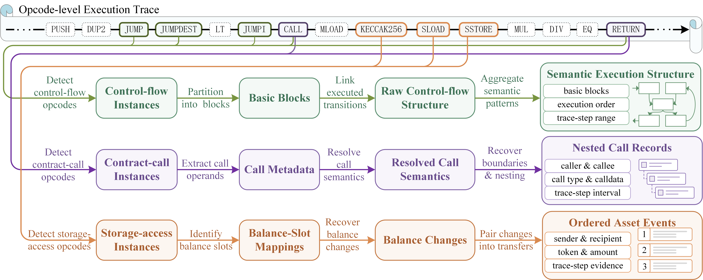

# TraceWeaver

TraceWeaver is a visual analysis tool for investigating Ethereum arbitrage transactions, including reverted attempts and transactions involving unverified contracts. It reconstructs token flows from execution traces and links them to contract calls and control-flow graphs. This repository includes a Python analysis backend, a Vue web interface.

## System overview

<p align="center">
  <a href="pics/system_showcase.pdf">
    
  </a>
</p>

*Linked token-flow, call-tree, and control-flow views. Select a transfer to inspect the calls and instructions behind it.*

## Trace Abstraction Algorithm

<p align="center">
  <a href="pics/trace_abstraction.pdf">
    
  </a>
</p>

*The backend converts opcode traces into control flow, nested calls, and ordered asset events.*

## Quick start

### Requirements

- Python 3.12+ and `uv`.
- Node.js 18+ and npm.
- Graphviz installed with `dot` available on `PATH` for server-side graph rendering.
- A Geth-compatible Ethereum JSON-RPC endpoint with `debug_traceTransaction` enabled and access to the historical state needed for the selected transactions.

### Backend

From the repository root:

```bash
cd backend
uv sync --locked
cp .env.example .env
```

Set `GETH_API` in `backend/.env` to your RPC endpoint. For historical traces that require the QuickNode fallback, set `QUICKNODE_RPC_URL` to your full endpoint URL; replace the example value.

Build the local function-signature database before the first analysis, then start the API:

```bash
uv run python signature/sync.py
uv run uvicorn server:app --port 9008
```

The initial signature sync downloads the full dataset and may take time; interrupted builds can be resumed by running the command again. The API is available at `http://localhost:9008`, with interactive documentation at `http://localhost:9008/docs`.

### Frontend

In a second terminal, from the repository root:

```bash
cd frontend
npm ci
npm run dev
```

Open `http://localhost:9006`, enter a mined contract-call transaction hash, and select **Analyze**. The development server proxies `/api` requests to the backend. Top-level contract-creation transactions and plain ETH transfers are currently unsupported by the analysis entry point.

### Command-line analysis

After backend setup, run the same transaction analysis without the web interface:

```bash
cd backend
uv run python main_api.py <transaction-hash>
```

Outputs are written to `data_base/analysis/<tx-hash-without-0x>/` at the repository root, including graph files, JSON evidence links, and `analysis_timing.json`.

## Repository guide

| Path                      | Contents                                                                               |
| ------------------------- | -------------------------------------------------------------------------------------- |
| [`backend/`](backend/)   | FastAPI service, trace analysis, graph construction, and local signature/label stores. |
| [`frontend/`](frontend/) | Vue 3 and TypeScript interface with linked graph views.                                |
